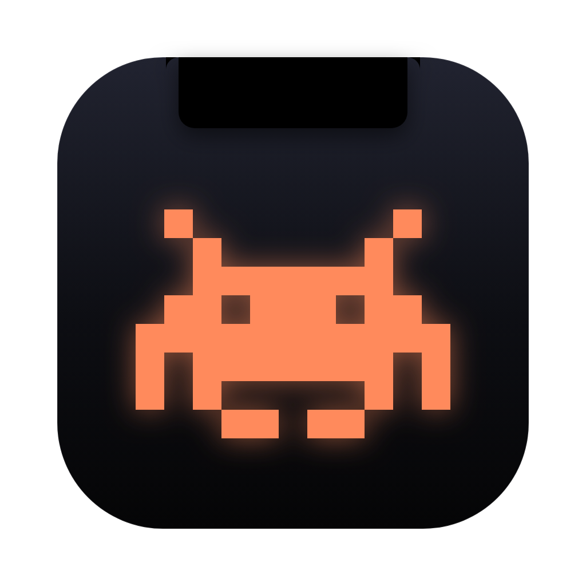
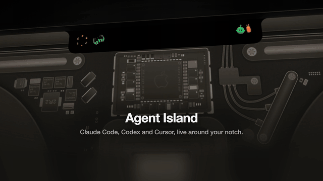

<p align="center">
  
</p>

<h1 align="center">Agent Island</h1>

<p align="center">
  <b>Watch and approve Claude Code, Codex & Cursor from your MacBook's notch.</b><br/>
  Native Swift. On-device Apple Intelligence. 100% local, no telemetry.
</p>

<p align="center">
  <a href="https://github.com/soummyaanon/DEV-island-releases/releases/latest"></a>
  <a href="https://github.com/soummyaanon/DEV-island-releases/releases"></a>
  
  
  <a href="LICENSE"></a>
</p>

<p align="center">
  
</p>

<p align="center">
  <a href="https://github.com/soummyaanon/DEV-island-releases/releases/latest/download/Agent-Island.dmg"><b>⬇ Download for macOS</b></a>
  &nbsp;·&nbsp; <a href="#features">Features</a>
  &nbsp;·&nbsp; <a href="#privacy">Privacy</a>
  &nbsp;·&nbsp; <a href="#build-from-source">Build from source</a>
  &nbsp;·&nbsp; <a href="CONTRIBUTING.md">Contribute</a>
</p>

---

Run agents in parallel across terminals and IDEs, and the island wraps your
notch to tell you, at a glance, who's working, who's done and who needs you.
Approve a command or answer an agent's question without leaving what you're
doing; click a session to jump straight back to its terminal.

## Why Agent Island

- **It acts, on-device.** An Ask bar backed by Apple's on-device model answers
  questions, knows what your agents are doing ("what is Claude doing?"), opens
  apps and sessions, sets timers and runs your Shortcuts. Nothing leaves the Mac.
- **Private by design.** No accounts, no API keys, no telemetry. The local
  server binds to `127.0.0.1` only. [Exactly two optional requests](#privacy)
  ever leave your machine, both listed below.
- **Native and light.** A Swift/SwiftUI app with no Dock icon and no menu-bar
  icon: the island *is* the app. It samples only while open and backs off in
  Low Power Mode.
- **More than agents.** Quick tools a swipe away: controls, a file shelf,
  clipboard, today's calendar, timers, widgets, a teleprompter and settings.

## Install

1. **[Download the DMG](https://github.com/soummyaanon/DEV-island-releases/releases/latest/download/Agent-Island.dmg)** (always the latest release).
2. Drag **Agent Island** into **Applications** and open it.
3. The first launch wires up Claude Code and Cursor hooks for you (existing
   hooks are kept, with backups). Codex needs nothing. Restart any agent
   sessions that were already running.

> [!IMPORTANT]
> This build isn't notarised yet. The first time you open it, macOS may say it
> "could not verify" the app: click **Done**, then **System Settings → Privacy &
> Security → Open Anyway**. Only needed once.
> Terminal alternative: `xattr -cr "/Applications/Agent Island.app"`

**Requirements:** macOS 14 or later on Apple Silicon. Works on any MacBook
notch size, and on Macs without a notch. The Ask bar's answers need Apple
Intelligence on macOS 26; everything else works without it.

## Agents

| Agent | How it connects | Setup |
| --- | --- | --- |
| **Claude Code** | HTTP hooks, all lifecycle events | automatic on first launch |
| **Codex** | read-only tail of its local rollout logs | none at all |
| **Cursor** | hooks plus a fire-and-forget bridge script | automatic on first launch |

Every session is a little robot: Claude Code is a clay-orange mech, Codex a
green droid, Cursor a blue hexagon. While an agent works, its dotted thinking
orb follows what it's doing: a scanning globe for search, a flowing sash for
edits, orbiting particles for commands.

## Features

- **Approve from the notch.** Permission requests appear as a card with the
  full command or diff. <kbd>⌘Y</kbd> / <kbd>⌘N</kbd> decide from anywhere;
  "Always allow" saves the same rule as Claude Code's own "don't ask again".
- **Answer questions from the notch.** Multiple-choice questions open the
  island; <kbd>⌘1</kbd>–<kbd>⌘9</kbd> or a click answers them.
- **Live sessions.** Project, elapsed time, current activity ("Running pnpm
  test"), host app and permission mode, colour-coded: working, waiting on you,
  done, failed. A developer strip adds context use, cost, uncommitted changes,
  the last test or build result, and running dev servers.
- **Jump back.** Click a session and its exact terminal comes forward: iTerm2
  tabs, Cursor, Terminal, Warp, Ghostty, WezTerm, VS Code.
- **Any edge.** Keep it on the notch, or drag it to the left or right edge,
  where it's a small notch of its own: the time at rest, each agent's orb at work.
- **Usage limits.** Claude Code's and Codex's 5-hour and weekly limits as small
  rings, read from their own local data. No token, no network.
- **Little delights.** Agents take a bow when they finish, confetti bursts out
  of the notch every million tokens, the notch glows when you plug in, and a
  live weather scene fills quiet moments (off by default).
- **Talk to it.** On-device speech in the Ask bar, with answers read back in a
  voice matched to your Siri.
- **Moves like a real object.** One black shape that grows on a damped spring;
  Reduce Motion, Increase Contrast and Reduce Transparency are all respected,
  and <kbd>⌃⌥⌘I</kbd> hands the island to VoiceOver.
- **Sound themes.** 8-bit, Arcade, Soft chimes or Anime, with per-event
  overrides. Quiet during Focus.

<details>
<summary><b>Quick tools in the swipe menu</b></summary>

Swipe sideways with two fingers (or click the dots in the open island):

| Page | What's there |
| --- | --- |
| Agents | Claude Code and Codex tokens today, sessions, limits, a 7-day chart, top projects |
| Controls | volume and output, brightness, Wi-Fi, Bluetooth, AirDrop, Focus, displays, battery |
| Files | a shelf: drop files on the notch, drag them back out, AirDrop them or hand them to an agent |
| Clipboard | text, links, images and files (password managers skipped; memory only) |
| Today | a month calendar beside the day's events, reminders and to-dos |
| Timers | countdowns and Pomodoro, with the time in the wings |
| Widgets | weather, stocks, a unit converter |
| Prompter | a teleprompter under the camera |
| Settings | position, how it opens, and the everyday switches |

Links for Shortcuts or launchers: `agent-island://tools/<page>`,
`agent-island://timer?minutes=10&label=Tea`, `agent-island://pomodoro`,
`agent-island://toggle`.
</details>

## Privacy

Everything about your sessions stays on your Mac. The local server binds to
`127.0.0.1` only, requests are token-authenticated, and there are **no
accounts, no API keys, no telemetry**. The Codex integration never writes a
byte to Codex's files, and the Cursor bridge returns instantly so Cursor never
waits on Agent Island.

Exactly two things ever leave your machine, both listed here in full:

| | What is sent | When | Turn it off |
| --- | --- | --- | --- |
| **Update check** | Nothing but the request itself, to the public GitHub Releases API | On launch, then hourly | Settings → General, or `AGENT_ISLAND_NO_UPDATE_CHECK=1` |
| **Weather** (off by default) | A latitude and longitude rounded to 2 decimals (~1 km), to `open-meteo.com`. No account, no key, no identifier | Every 15 minutes while enabled | Settings → Weather |

**Nothing about your sessions, prompts, projects or agents is ever
transmitted.** The Ask bar runs on Apple's on-device model; only one line per
session (project, state, activity) is given to it.

## How it works

```
Claude Code ──HTTP hooks──▶
Cursor ───bridge script───▶   local daemon (127.0.0.1:7433)   ──stream──▶   the island (SwiftUI)
Codex rollout logs ◀──tail──  canonical events → session state
```

The app hosts a small daemon that normalises each agent's signals into one
event vocabulary, folds them into per-session state and streams snapshots to
the island. Hooks are safe-merged into `~/.claude/settings.json` and
`~/.cursor/hooks.json`; if the app isn't running, the hook scripts exit
quietly so your agents never see an error.

## Build from source

```sh
cd apps/mac
./scripts/test.sh                 # Swift Testing suites
./scripts/bundle.sh debug --open  # build and launch build/Agent Island Next.app
```

It builds with the Xcode Command Line Tools alone. See
[CONTRIBUTING.md](CONTRIBUTING.md) for the layout, debug helpers and how to
add an agent. (`packages/` holds the 1.x Electron app, kept for reference; the
shipping app is `apps/mac`.)

## FAQ

<details>
<summary><b>macOS says it can't verify the app</b></summary>

The build isn't notarised yet. Open it once from System Settings → Privacy &
Security → Open Anyway, or run `xattr -cr "/Applications/Agent Island.app"`.
</details>

<details>
<summary><b>How do I uninstall it and remove the hooks?</b></summary>

Quit the app and delete it from Applications. Then remove the entries that
point to `~/.agent-island/bin/` from `~/.claude/settings.json` and
`~/.cursor/hooks.json` (timestamped backups sit next to them), and delete
`~/.agent-island`.
</details>

<details>
<summary><b>Does it work without a notch, or with an external display?</b></summary>

Yes. It measures the hardware notch at startup and falls back to a notch-sized
island on Macs without one. With an external display as main, it still goes on
your notched screen.
</details>

<details>
<summary><b>Does it need Apple Intelligence?</b></summary>

Only for the Ask bar's free-form answers (macOS 26 with Apple Intelligence on).
Without it, the Ask bar still opens apps, sites and sessions, searches, sets
timers and the volume, and runs your Shortcuts.
</details>

## Contributing

Bug reports, ideas and pull requests are welcome: start with
[CONTRIBUTING.md](CONTRIBUTING.md), and see the
[good first issues](https://github.com/soummyaanon/DEV-island/labels/good%20first%20issue).
Questions go to [Discussions](https://github.com/soummyaanon/DEV-island/discussions).

## Acknowledgements

Bot avatars and thinking orbs are native ports of
[bot-avatars](https://libraries.dev/bots.html) and
[thinking-orbs](https://libraries.dev/orbs.html) from libraries.dev.

## License

[MIT](LICENSE) © Soumyaranjan Panda

<p align="center">
  <a href="https://star-history.com/#soummyaanon/DEV-island&Date">
    
  </a>
  <br/>
  <sub>If Agent Island saves you a context switch, a ⭐ helps other developers find it.</sub>
</p>
